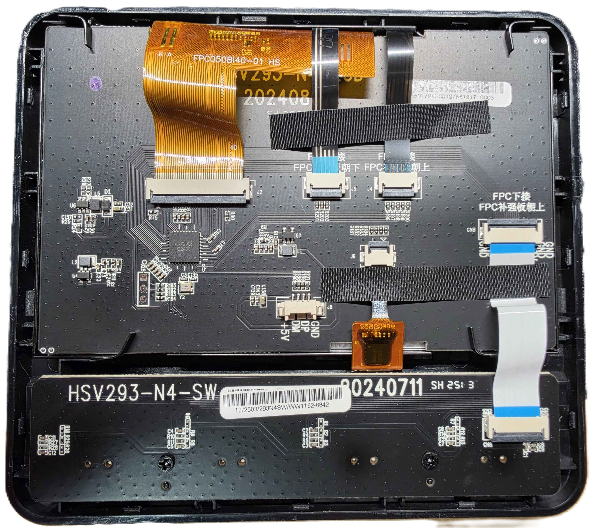

# Hardware

Everything here was read from the device itself (UART log, flash dump), from the stock firmware, or from the board
photo. Items that are guesses are marked as such.

## Device

* Product: Ajazz **AKP05E** stream dock. PCB markings: `HSV293-N4-SW` (key board) and a main board with a display module
  (`FPC050BI40-01 HS`, probably 5 inch). Image header product string: `HSV293V3-N4`.
* SoC: **ArtInChip D13x**, package marking `ARX2903 Q2403`. 32-bit RISC-V with T-Head extensions
  (`-march=rv32imafdcpzpsfoperand_xtheade`, `-mabi=ilp32d`), cache line 32 bytes.
* Flash: 16 MiB SPI NOR, ZBIT (JEDEC id `0x5e4018`), on QSPI0.
* RAM: 8 MiB external PSRAM at `0x40000000` (`AIC_PSRAM_SIZE = 0x800000`) plus the on-chip SRAM
  (`0x30040000 - 0x30140000`, holds the RT-Thread heap).
* Display: 800x480 parallel RGB (24 bit data, pins PD.0 - PD.27), SDK driver `panel-rgb`, pixel clock 30 MHz,
  horizontal sync 48 / back porch 40 / front porch 40, vertical sync 3 / back porch 29 / front porch 13.
  Frame buffer format RGB565.
* Backlight: PWM, device `pwm`, channel 2 (pad PE.13, function 3), period 1 ms, duty = level x 10 us, level 15..80.
* USB: one device port (HS), vendor id `0x0300`, product id `0x3004`, strings `HOTSPOTEKUSB` and
  `HOTSPOTEKUSB HID DEMO`. The serial number is the first 12 hex digits of the 16-byte chip id (eFuse offset 16).
  The stock descriptors are reused byte for byte (`firmware/app/usb_desc_blob.inc`).

## Flash layout

SPI NOR, 16 MiB, defined in `firmware/image/image_cfg.json` (the same table is compiled into the stock bootloader):

| Partition | Offset | Size | Content |
|---|---|---|---|
| `spl` | 0x000000 | 512 KiB | bootloader (tinySPL + HID upgrade code); **never written by this project** |
| `env` | 0x080000 | 128 KiB | bootloader environment |
| `env_r` | 0x0A0000 | 128 KiB | redundant copy of the environment |
| `os` | 0x0C0000 | 2 MiB | FIT image with the firmware |
| `rodata` | 0x2C0000 | 1 MiB | FAT image |
| `data` | 0x3C0000 | 10 MiB | littlefs image, contains `/data/logo_jpg_dir/test_logo.jpg` |

`env.bin` is written to both `env` and `env_r`. The bootloader environment (`firmware/image/env.txt`) holds the A/B
slot state (`osAB_*`), `bootlimit=5`, `bootcount`, `upgrade_available`.

## Pin map

Recovered from the stock firmware (`firmware/board/akp05-nor/pinmux.c`, `firmware/app/input.c`).

| Function | Pins |
|---|---|
| UART0 console (115200 8N1) | PA.0 = TX, PA.1 = RX (pull-up). **PA.0 is also the "enter upgrade mode" strap** |
| I2C2 (touch controller, address 0x38) | PA.8, PA.9 |
| Display data | PD.0 - PD.27, PE.14 (function 2) |
| USB data (probably) | PO.0, PO.1 (function 2) |
| Backlight PWM2 | PE.13 |
| Key matrix: rows (driven low one at a time) | PC.0, PB.2, PB.1 |
| Key matrix: columns (pull-up inputs) | PC.5, PC.4, PC.3, PC.2, PC.1 |
| Encoder 1: A / B, push | PB.6 / PB.7, PE.15 |
| Encoder 2: A / B, push | PB.9 / PB.10, PB.8 |
| Encoder 3: A / B, push | PE.12 / PE.14, PE.11 |
| Encoder 4: A / B, push | PA.4 / PA.5, PB.11 |
| LED strip | QSPI device, 24 LEDs (see below) |

`PE.14` appears both in the display function list and as encoder 3 pin B; this is how the stock firmware configures it.

### Keys, encoders, touch strip

* **Key matrix**: 3 rows x 5 columns. The key code table of the stock firmware gives codes 1..10 for rows 1 and 2 and
  code 0 for row 3 (third row not used). The LCD tiles are 112x112 pixels, 5 per row, origin (5, 15), pitch (169, 174).
* **Encoders** (EC11, four of them): quadrature decoder on the falling / rising edge of A, direction from B. Report
  codes: counter-clockwise `0x50 / 0x90 / 0xa0 / 0x70`, clockwise = code + 1. Push buttons: `0x35 / 0x33 / 0x37 / 0x36`.
* **Touch strip**: I2C controller at 0x38 (register 2, 7 bytes), coordinates 0..800 x 0..120. Four tiles of 176x112
  pixels (codes `0x40 - 0x43`), x origins 5 / 204 / 403 / 602.
* **LED strip**: 24 RGB LEDs driven as a bit stream through QSPI (bit 1 = 0x78, bit 0 = 0x60). In the **stock image the
  QSPI device pointer is never assigned**, so the strip is never driven ("QSPI device is not init yet"). The
  reconstruction keeps the routine as it is. The LED commands are accepted and stored.

## UART access

Three pads in a vertical row below and to the left of the SoC (marked `ARX2903 Q2403`), next to the resistor group
R191-R195: **GND, TX (PA.0), RX (PA.1)**, 3.3 V logic, 115200 8N1. Find GND with the continuity beeper; the pad that
puts the device into the BootROM mode when it is shorted to GND at power-on is TX. J8 (`GND, DP, DM, +5V`) is the
connector of the USB cable. The photo shows the main board with the display module lifted off:

Any 3.3 V USB-UART works
(a Raspberry Pi Pico running a UART bridge firmware was used). Connect GND and the device's TX to the adapter's RX
to watch the log; connect the adapter's TX to the device's RX to type shell commands. Do not connect a power line.
The device's own USB cable provides the power.

The console shows the bootloader log, the kernel log and the RT-Thread shell (`arx />`). Shell commands added by
this project: `upghid`, `fbinfo`, `fbfill [RRGGBB|bars] [page]`, `showlogo`. Standard ones: `help`, `ps`, `free`,
`reboot`, `aicupg`.

## Memory map

| Address | Content |
|---|---|
| `0x18700000` | GPIO controller (PA.0 strap is read here by the SPL) |
| `0x19030100` | reboot-reason register (bits 7:4) |
| `0x30040000 - 0x30140000` | SRAM S0: RT-Thread heap, updater PSRAM-init stage (`0x30044000`) |
| `0x40000000 - 0x40210000` | PSRAM "software" region: bootloader, updater (`0x40100000`) |
| `0x40210000` | **firmware load address and entry point** |
| about `0x40288000 - 0x40800000` | PSRAM CMA heap (about 5.5 MB): frame buffers, rings, decoder buffers (start depends on the image size) |
